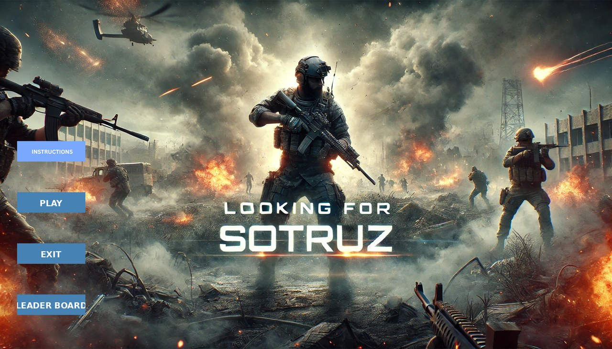
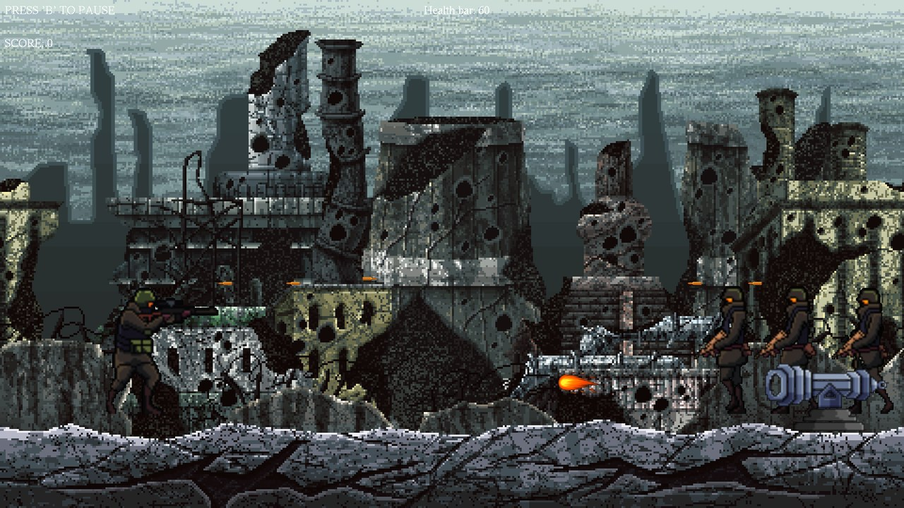
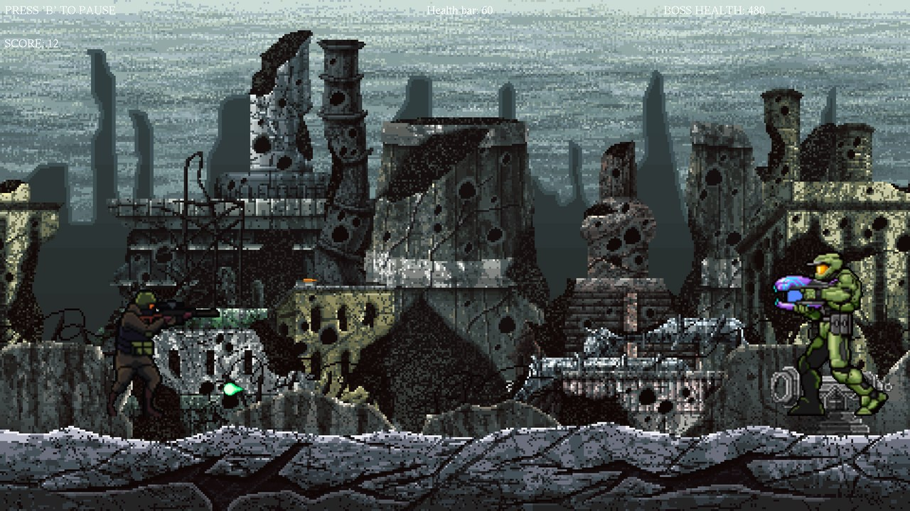

# Looking For Sotruz


My first game: a 2D side-scrolling shooter written in C++ with the **iGraphics** library (OpenGL / GLUT), made as my CSE 102 (Level 1, Term 1) project.

Hold off waves of soldiers, take out an enemy cannon, survive an ambush from both sides and defeat the final boss.



<table>
  <tr>
    <td></td>
    <td></td>
  </tr>
  <tr>
    <td align="center">Stage 1: hold the line</td>
    <td align="center">Stage 3: the boss</td>
  </tr>
</table>

## Gameplay

### Stage 1: Hold the line
- Three waves of 4 soldiers march in. Each soldier goes down after 2 hits.
- The soldiers fire every second: **sit** to duck under their bullets.
- A cannon on the right fires bombs along the ground: **jump** over them.
- After 6 kills, two health crates drop from the sky. **Shoot a crate** to refill your health.
- Clear all three waves to unlock movement, then pick up the **laser gun** that drops on the field.
- Destroy the cannon with **grenades**. It takes two hits.

### Stage 2: Ambush
- With the cannon gone, a supply crate appears. Walk onto it to restore full health. Stage 2 starts 10 seconds later.
- Three soldiers charge from the right, then three more from the left. Each takes 4 hits, and any soldier that reaches you costs 25 health.
- You can now turn around and shoot in both directions.

### Stage 3: The boss
- The boss has 500 health and alternates between low and high shots: **jump** over the low ones, **sit** under the high ones. Each hit costs 20 health.
- Defeat it to complete the mission and roll the credits.

### Scoring
- If you die, your score is the number of enemies you killed.
- If you win, your score is **30 + your remaining health**.
- After each game you can type your name. The top 5 scores are saved in `Score.txt` and shown on the **Leader Board**.

## Controls

| Key | Action |
| --- | --- |
| `W` | Jump (also stands you back up after sitting) |
| `S` | Sit / duck |
| `A` / `D` | Move left / right (after the first three waves) |
| `Space` | Shoot |
| `G` | Throw a grenade at the cannon (after the first three waves) |
| `B` | Pause and return to the menu (press **PLAY** to resume), or go back from any screen |
| `Q` / `End` | Quit |
| `Enter` / `Backspace` | Confirm / edit your name on the score screen |

Use the mouse to pick an option in the main menu.

## Running the game

The game runs on **Windows**.

1. Clone or [download](https://github.com/SadMan-ZaMaN/Looking-For-Sotruz/archive/refs/heads/main.zip) the repository:
   ```
   git clone https://github.com/SadMan-ZaMaN/Looking-For-Sotruz.git
   ```
2. Open the folder and run **`iMain.exe`**.

Keep `iMain.exe` inside the project folder: it loads its images and music from the folders next to it and needs `glut32.dll`, which is included.

> **Window doesn't fit on your laptop?** The game is designed for a 1920×1080 window. With Windows display scaling (125%, 150%, 200%) the window can end up partly off-screen. Right-click `iMain.exe` → **Properties** → **Compatibility** → **Change high DPI settings**, tick **Override high DPI scaling behavior** and choose **Application**. Windows then draws the game at its real 1920×1080 size instead of stretching it.

## Building from source

You need a 32-bit **MinGW g++** set up for iGraphics, with the OpenGL and GLUT libraries (`glut32`, `glaux`). This is the usual CSE 102 setup.

```
g++ iMain.cpp -o iMain.exe -lopengl32 -lglu32 -lglut32 -lglaux -lwinmm -static-libgcc -static-libstdc++
```

`-static-libgcc -static-libstdc++` bundles the C++ runtime into the `.exe` so it also runs on PCs without MinGW installed. Run the result from the project folder, as above.

## Project structure

```
Looking-For-Sotruz/
├── iMain.cpp             the game: menu, three stages, boss fight, leaderboard
├── iGraphics.h           iGraphics library (drawing, input and timers on top of GLUT)
├── stb_image.h           image loader used by iGraphics
├── glut32.dll, glu32.dll runtime libraries
├── Score.txt             top 5 scores (written by the game)
├── Home/                 main menu art and buttons
├── img/                  instructions, leaderboard and credits screens
├── HeroMovement/         player and enemy sprites, background
├── cannon/  grenade/  bullet/  special/  masterchief/
│                         cannon, grenades, bullets, pickups and the boss
├── Music/                menu music and ending song
├── screenshots/          images used in this README
├── rough.cpp             an earlier draft of the game (kept for reference)
└── scoreboard.cpp        a small prototype of the name entry and leaderboard
```

## Built with

- **C++**
- **[iGraphics](https://github.com/mahirlabibdihan/iGraphics)**: a small OpenGL/GLUT wrapper by S. M. Shahriar Nirjon (modified by Mohammad Saifur Rahman), used for CSE 102 projects
- **OpenGL** and **GLUT**
- **[stb_image](https://github.com/nothings/stb)** for loading images
- The Windows multimedia API (`PlaySound`) for music

## Author

**Sadman Zaman** ([@SadMan-ZaMaN](https://github.com/SadMan-ZaMaN)), CSE 102 (Level 1, Term 1) project.

Sprites, artwork and music belong to their respective owners and are used here for a non-commercial student project.
